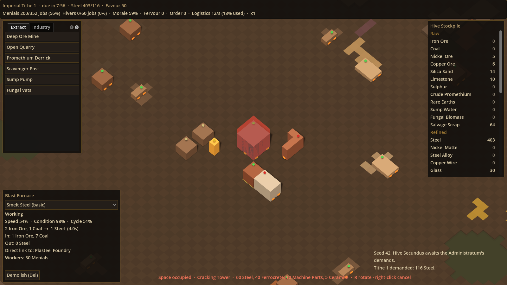

# Anno M36

A Warhammer 40,000 hive-city economic builder in Godot. Build a military-industrial hive that meets the Imperial tithe, while keeping four castes of citizens fed, comforted, devout or policed.

This is the first playable scaffold: placement, production chains, a working economy and the tithe loop, with placeholder visuals. See the design document for the full vision.



## Running it

1. Install [Godot 4.4](https://godotengine.org/download) or newer (standard build, not .NET).
2. Open Godot, choose **Import**, and select `project.godot` in this folder.
3. Press **F5** to play.

Each run picks a random map seed. Set `world_seed` on the World node in `scenes/main.tscn` to replay a map.

## Controls

| Input | Action |
| --- | --- |
| WASD / arrow keys, middle-drag | Pan |
| Mouse wheel | Zoom |
| Q / E | Rotate the view 90° |
| Left click | Place building (build mode) or select (otherwise) |
| R | Rotate the building being placed |
| Right click / Esc | Leave build mode or deselect |
| Delete or X | Demolish selected (50% refund) |
| U | Upgrade selected housing |
| Space, 1, 2, 3 | Pause, normal, x2, x4 speed |

Bindings can be remapped in Project Settings > Input Map; anything defined there overrides the defaults in `scripts/core/input_setup.gd`.

## How the prototype plays

- **Tithe.** Every 8 minutes the Administratum takes its quota from the stockpile. The first is always steel; later cycles grow and rotate between plasteel, promethium, lasguns, power packs, autogun rounds and flak armour. Full delivery raises favour, under 75% lowers it.
- **Placement.** Buildings are polyominoes (rectangles, L, T and S shapes, never with holes). Blue markers are input ports, orange are outputs.
- **Direct links.** When an output port faces another building's input port, goods pass straight across for free. Everything else goes through the hive stockpile and spends **logistics** capacity (the Bastion gives 12 units/s, each Cargo Depot 6). Tight, linked layouts beat sprawl.
- **Deposits are finite.** Mines must sit on a matching deposit; output scales with how much of the footprint covers it, and deposits run dry.
- **Workers and needs.** Housing holds one caste. Upgrades keep the footprint and add capacity (a slum becomes a block of flats); castes never turn into each other. Unmet basic needs shrink the workforce.
- **Morale.** Comfort goods, Fervour (Shrines using devotional icons) and Order (Enforcer Precincts using kits) each raise morale, which scales every building's speed.
- **Maintenance.** Buildings lose condition and slow down below 60%. They repair themselves with machine parts from the stockpile.

## Project layout

```
data/            Generated .tres definitions (items, recipes, buildings, castes)
tools/gen_data.py  Source of truth for all game data; regenerates data/
scripts/data/    Resource classes and the Database autoload
scripts/grid/    Footprint rotation and the dictionary-based placement grid
scripts/sim/     Economy (stockpile simulation), building state, tithe
scripts/world/   Terrain generation and mesh, deposit scatter, main World node
scripts/view/    Camera, placement controller, placeholder building visuals
scripts/ui/      HUD, built in code
tests/           Headless test suite and a screenshot helper
```

## Changing game data

All items, recipes, buildings and castes live in `tools/gen_data.py`, so balancing happens in one readable file. After editing it:

```
python3 tools/gen_data.py
```

This checks references (unknown items, ports facing inwards, upgrades that change footprint) and rewrites `data/`. Don't edit the `.tres` files by hand; they are overwritten.

The current set is 41 goods: 12 raw, 14 refined, 5 components and 10 finished (4 tithe goods and 6 civic goods).

## Tests

```
godot --headless --path . res://tests/test_runner.tscn
```

Covers data integrity, footprint rules, rotation, placement, port linking, the production chain, deposit depletion, maintenance, the tithe and terrain generation. Exits non-zero on failure.

## Not built yet

Mapped against the design document, these are stand-ins or still to do:

- **Districts.** Workforce, needs and morale are hive-wide for now. The design calls for per-district stockpiles fed by the transport networks.
- **Transport networks.** Logistics is a single capacity number. Pedestrian, civilian traffic and cargo rail graphs come next.
- **Crowds.** No boids yet.
- **Tech tree and unlocks.** Everything is available from the start, including the advanced steel route (Matte Smelter → Alloy Forge → Rolling Mill).
- **Building modules**, the module-slot rules are still an open design question.
- **Pressure events** (accidents, plague, warp storms, audits, cults) and population drift.
- **Win and loss conditions**, still open in the design doc.
- **Menus**: production statistics, in-game wiki, settings, objectives.
